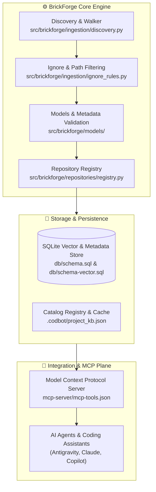

# brickForge
An AST-aware, multi-repository code intelligence and component catalog that indexes distributed source code across local drives and repositories into a unified knowledge base.

# BrickForge (`brickforge-mcp`)

> **Sovereign AST Code Intelligence & Composable Component Registry for AI Agents and Engineers.**

---

## 🎯 Vision & Value Proposition

In modern enterprise codebases, components, utility functions, schemas, and configurations are often fragmented across multiple micro-repositories or mono-repo silos. **BrickForge** acts as an autonomous indexing forge:
- It discovers, parses, analyzes, and registers reusable code modules ("Bricks").
- It captures function/class contracts, imports, dependencies, call signatures, and documentation into a structured SQLite/JSON store.
- It exposes a unified **MCP (Model Context Protocol)** server allowing AI coding assistants (such as Antigravity, Claude Code, Cursor, Copilot) to discover, inspect, and compose existing code modules with zero guesswork.

The distinction is important:
- Cursor is strongly associated with AI-assisted editing inside an IDE.
- Claude Code is strongly associated with agentic coding in a repository and terminal.
- Copilot spans coding assistance and an increasingly broad agent ecosystem.
- Antigravity positions itself around agent-driven development workflows.
CodBot could differentiate itself by making the entire engineering lifecycle its core product: understand, plan, implement, test, review, integrate, and report—with evidence and controlled permissions at every step.

---

## 🏛️ System Architecture



---

## 📂 Repository Layout

```text
c:\Dev\brickForge
├── brickforge/            # Core schemas, MCP specs, and architecture documents
│   ├── ARCHITECTURE.md    # In-depth architectural blueprint
│   ├── MCP_SERVER.md      # MCP server protocol specification
│   ├── mcp-tools.json     # MCP tool declaration contracts
│   └── schema.sql         # Base database relational schema
├── db/                    # Database DDL & migration scripts
│   ├── schema.sql         # Relational schema
│   └── schema-vector.sql  # Vector embeddings schema for semantic search
├── docs/                  # Documentation & design notes
├── mcp-server/            # MCP server interfaces and tool definitions
├── src/brickforge/        # Primary Python source package
│   ├── config.py          # Configuration and settings loader
│   ├── ingestion/         # Repository scanning, paths, and ignore filters
│   ├── models/            # Dataclasses & Pydantic models for scans & repos
│   └── repositories/      # Repository registry & catalog persistence
├── tasks/                 # Task manifests & DAG definitions (tasks.json)
├── tests/unit/            # Pytest automated test suite
├── tools/                 # Reference screenshots, specifications & tools
└── pyproject.toml         # Python packaging & test configurations
```

---

## 🚀 Quickstart & Verification

### 1. Prerequisites
- Python 3.12+ (tested up to 3.14)
- Git 2.40+

### 2. Environment Setup
```powershell
# Clone the repository
git clone https://github.com/titwan37/brickForge.git
cd brickForge

# Install editable package & test dependencies
python -m pip install -e ".[dev]"
```

### 3. Run Test Suite
```powershell
python -m pytest tests/unit/
```

---

## 📜 License
MIT License. Crafted for resilient autonomous software development.
