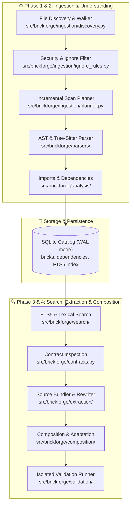

# BrickForge (`brickforge`)

> **Sovereign AST Code Intelligence & Composable Component Registry for AI Agents and Engineers.**

[](https://www.python.org/downloads/)
[](LICENSE)
[]()

---

## 🎯 Vision & Value Proposition

In modern software organizations, code components, utility functions, schemas, and algorithms are often fragmented across multiple micro-repositories or mono-repo silos. **BrickForge** acts as an autonomous indexing forge:
- **Discovers and Indexes**: Statically parses and registers reusable code modules ("Bricks") across local repositories into an authoritative SQLite catalog.
- **Extracts Contracts**: Captures type-annotated signatures, docstrings, parameters, return types, and pure-function invariants without running the source code.
- **Resolves Dependency Graphs**: Traverses calls and inheritance hierarchies to assemble self-contained source bundles with rewritten imports and provenance manifests.
- **Composes & Adapts**: Generates adaptation proposals for target environments with unified diffs, licensing reports, and review workflows.
- **Validates in Isolation**: Automatically tests extracted bundles using syntax compilation, dependency checks, and unit test harnesses.
- **Agent Integration**: Exposes a Model Context Protocol (MCP) server for seamless discovery by AI coding agents (Antigravity, Claude Code, Cursor, Copilot).

---

## 🏛️ System Architecture



---

## 📂 Repository Layout

```text
c:\Dev\brickForge
├── docs/                  # Documentation & operational guides
│   ├── quickstart.md      # Getting started, CLI, Python API, and database ops
│   ├── security.md        # Security boundaries, traversal checks, and execution guarantees
│   ├── ARCHITECTURE.md    # Detailed architectural specifications
│   └── DESIGN_PACK.md     # Engineering lifecycle and roadmap
├── src/brickforge/        # Primary Python source package
│   ├── analysis/          # Call graphs, dependencies, and symbol indexing
│   ├── composition/       # Composition models, adaptation service, and approval workflow
│   ├── extraction/        # Bundling, import rewriter, manifest, and output formatters
│   ├── ingestion/         # Discovery, fingerprints, path sanitization, and scan planner
│   ├── parsers/           # Python AST and Tree-Sitter error recovery runtime
│   ├── search/            # SQLite FTS5 search service and query models
│   ├── storage/           # SQLite migrations, connection manager, and brick repository
│   ├── validation/        # Isolated test runners, syntax checking, and validation reports
│   └── cli.py             # CLI commands (init, scan, search)
├── tasks/                 # Task tracking manifests (tasks.json)
├── tests/                 # Automated test suite
│   ├── unit/              # Fast unit test coverage
│   ├── integration/       # Database, FTS, and persistence integration tests
│   ├── e2e/               # End-to-end vertical slice & incremental indexing tests
│   ├── security/          # Filesystem boundary, symlink, and traversal security tests
│   └── performance/       # Ingestion throughput and search latency baseline tests
└── pyproject.toml         # Packaging specification
```

---

## 🚀 Quickstart

### 1. Installation

```bash
# Clone the repository
git clone https://github.com/titwan37/brickForge.git
cd brickForge

# Install editable package
python -m pip install -e .
```

Verify installation:
```bash
python -m brickforge --help
```

### 2. Basic Operations

```bash
# Initialize local SQLite catalog and search tables
python -m brickforge init

# Scan a local repository
python -m brickforge scan --repo-path /path/to/my-repo --repo-id my-repo

# Search for components in the catalog
python -m brickforge search "calculate_total"
```

For detailed CLI and Python API examples, see [docs/quickstart.md](file:///C:/Dev/brickForge/docs/quickstart.md).

---

## 🔒 Security Model

BrickForge adheres to strict security invariants:
1. **Never Executes Scanned Code**: All parsing and analysis is strictly static via `ast.parse` and tree-sitter.
2. **Filesystem Boundaries**: Enforces `safe_path_canonicalization` to block parent traversal (`../`) and external symlink escape.
3. **Sensitive File Filtering**: Automatically ignores `.git`, `.env`, `.venv`, `node_modules`, and credentials.
4. **Allowlisted Exports**: Composed code is only exported to explicitly permitted destination paths.
5. **Subprocess Isolation**: Validation runs in isolated subprocesses with enforced timeouts.

For complete details, see [docs/security.md](file:///C:/Dev/brickForge/docs/security.md).

---

## 🧪 Running Tests

Always execute tests using the Python module invocation:

```bash
# Run all unit tests
python -m pytest tests/unit/

# Run integration tests
python -m pytest tests/integration/

# Run end-to-end tests
python -m pytest tests/e2e/

# Run security boundary tests
python -m pytest tests/security/

# Run performance baseline tests
python -m pytest tests/performance/

# Run full test suite
python -m pytest
```

---

## Review of `config/repositories.json` & `scripts/sync_repositories.py`

Both files have been reviewed and refined to work seamlessly together.

### 1. Review of `config/repositories.json`

**Status**: **Valid & Production Ready**

- **Structure**: Clean, valid JSON structure with 8 repository roots across `C:`, `L:`, `G:`, OneDrive, and Visual Studio versions.
- **Path Escaping**: All Windows backslashes (`\\`) are correctly escaped.
- **Exclusion Rules**: 
  - Standard development artifacts are excluded (`.git`, `.venv`, `node_modules`).
  - Visual Studio build directories (`bin/`, `obj/`, `.vs/`, `Debug/`, `Release/`, `ipch/`) and compiler metadata (`*.sdf`, `*.suo`) are filtered out.
  - Added protections for `dev-c`: excludes database binaries (`*.db`, `*.sqlite`, `**/data/**`) and pytest cache (`**/.pytest_cache/**`), preventing internal database files from being indexed as code.

---

### 2. Review of `scripts/sync_repositories.py`

**Status**: **Enhanced & Tested**

The script has been updated with several key improvements:
1. **Automatic Path Resolution**: Automatically checks `config/repositories.json` by default (as well as `repositories.json` in the root).
2. **Custom Ignore Enforcement**: Directly injects the `exclude_globs` configured for each repository into `IgnoreRules` during scan planning.
3. **Database Migration & Auto-Creation**: Applies migrations and creates `data/brickforge.db` if it doesn't already exist.
4. **CLI Argument Parser (`argparse`)**:
   - `--config PATH`: Specify a custom config file.
   - `--repo ID`: Scan only a single repository (e.g. `--repo dev-c` or `--repo vs-2019`).
   - `--no-scan`: Sync and register the repositories in the database without immediately triggering a full scan.
   - `--force`: Force re-indexing of unchanged files.
5. **Safe Inaccessible Path Handling**: If a cloud drive (`L:\My Drive` or `G:\My Drive`) or disconnected drive is not accessible, it logs a clear `[WARN]` and proceeds with the other repositories rather than crashing.

---

### 3. How to Use

Open your terminal in `c:\Dev\brickForge`:

#### Option A: Register Repositories Without Scanning Immediately
Quickly syncs your 8 repository definitions into the SQLite catalog:
```powershell
python scripts/sync_repositories.py --no-scan
```
*Output:*
```text
[BrickForge] Loading repository configuration: C:\Dev\brickForge\config\repositories.json
[BrickForge] Synced 8 repositories into catalog: C:\Dev\brickForge\data\brickforge.db
[BrickForge] Scan skipped (--no-scan). Repositories are registered.
```

#### Option B: Scan a Single Repository
If you want to test indexing on a specific repository first (e.g. `dev-c`):
```powershell
python scripts/sync_repositories.py --repo dev-c
```

#### Option C: Full Sync and Scan of All Enabled Repositories
Scans all 8 repositories, discovers AST symbols, and indexes them into the catalog:
```powershell
python scripts/sync_repositories.py
```

#### Option D: Force a Complete Re-index
Bypasses the SHA-256 cache and forces all files to be re-parsed:
```powershell
python scripts/sync_repositories.py --force
```

---

### 4. Searching Your Indexed Repositories

Once scanned, you can query your newly built code catalog:

```powershell
# Search using the BrickForge CLI
python -m brickforge search "your_function_or_class_name"
```

Or query via Python:
```python
from pathlib import Path
from brickforge.storage.database import DatabaseManager
from brickforge.search.service import CatalogSearchService, CatalogQuery

db_mgr = DatabaseManager(db_path=Path("data/brickforge.db"))
search = CatalogSearchService(db_mgr)

# Search across all 8 repositories
hits = search.search(CatalogQuery(query="UserService", limit=10))
for hit in hits:
    print(f"{hit.symbol_name} ({hit.kind}) in [{hit.repository_id}] {hit.relative_path}")
```


---

## 📜 License
MIT License. Crafted for resilient autonomous software development.
