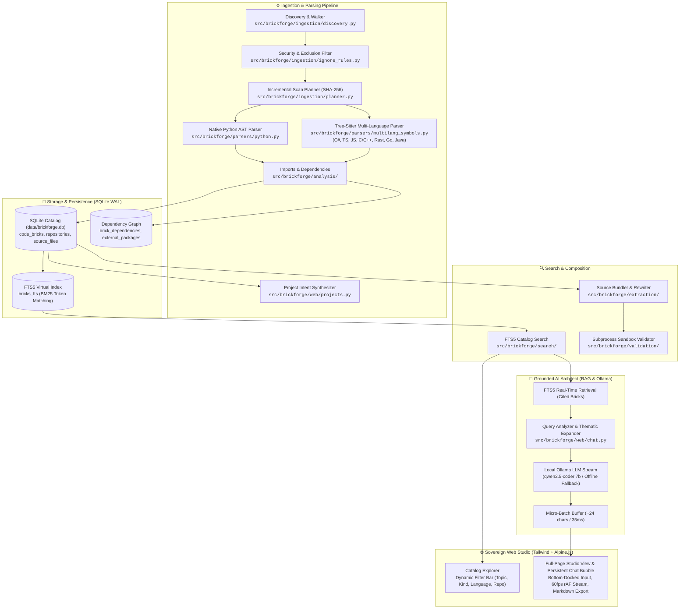

# BrickForge (`brickforge`)

> **Sovereign AST Code Intelligence & Composable Component Registry for AI Agents and Engineers.**

[](https://www.python.org/downloads/)
[](LICENSE)
[]()
[]()
[]()

---

## 🎯 Vision & Value Proposition

In modern software ecosystems, high-value code components, utility algorithms, schema models, and architectural patterns are scattered across local repositories, legacy drives, and monorepo silos. **BrickForge** transforms your local codebase into an autonomous, searchable component registry:

- **Indexes at Scale**: Statically parses and registers **160,000+ reusable code modules ("Bricks")** and **280+ projects** across local repositories into an authoritative SQLite database.
- **Multi-Language AST Extraction**: Native Python AST plus Tree-sitter grammars across **Python, C#, TypeScript/TSX, JavaScript, C/C++, Rust, Go, and Java**.
- **Extracts Clear Contracts**: Captures type-annotated signatures, docstrings, parameters, return types, cyclomatic complexity, and self-containment portability scores without running source code.
- **Project-Level Intelligence**: Aggregates multi-file directories into project-level entries (`kind=project`) with AI-synthesized architectural intent and metric rollups.
- **Grounded AI Architect**: Features a local, conversational assistant powered by local Ollama LLMs (`qwen2.5-coder:7b`, `llama3.2:3b`), grounded in real-time by SQLite FTS5 lexical BM25 retrieval.
- **Sovereign & Zero-Build**: Runs 100% locally with a zero-build Tailwind CSS + Alpine.js web studio, requiring no external cloud dependencies or telemetry.

---

## 🏛️ System Architecture



---

## 💻 Multi-Language Support Matrix

BrickForge parses source files using high-performance, error-tolerant parsers tailored to each language ecosystem:

| Language | Extensions | Parser Engine | Extracted Symbols |
|---|---|---|---|
| **Python** | `.py` | Native `ast` (Python 3.10+) | Functions, Async Functions, Classes, Methods |
| **C#** | `.cs` | Tree-sitter (`csharp`) | Classes, Interfaces, Structs, Enums, Methods, Properties |
| **TypeScript / TSX** | `.ts`, `.tsx` | Tree-sitter (`typescript`, `tsx`) | Functions, Classes, Interfaces, Type Aliases, Methods |
| **JavaScript / JSX** | `.js`, `.jsx`, `.mjs` | Tree-sitter (`javascript`) | Functions, Classes, Methods |
| **Rust** | `.rs` | Tree-sitter (`rust`) | Functions (`fn`), Structs, Traits, Enums, Impl Methods |
| **C / C++** | `.c`, `.cpp`, `.cc`, `.h`, `.hpp` | Tree-sitter (`c`, `cpp`) | Functions, Classes, Structs, Enums, Methods |
| **Go** | `.go` | Tree-sitter (`go`) | Functions (`func`), Methods, Structs, Interfaces |
| **Java** | `.java` | Tree-sitter (`java`) | Classes, Interfaces, Methods, Enums |

---

## 📂 Repository Layout

```text
c:\Dev\brickForge
├── config/                # Repository registration manifests
│   └── repositories.json  # Multi-root repository definitions & exclude globs
├── docs/                  # Architecture & operational specifications
│   ├── ARCHITECTURE.md    # In-depth system & RAG streaming architecture
│   ├── quickstart.md      # CLI, Python API, and database operations guide
│   └── security.md        # Static security boundaries and path canonicalization
├── scripts/               # Operational utility scripts
│   ├── serve_catalog.py   # One-click FastAPI web server launcher
│   └── sync_repositories.py # Multi-root incremental sync & indexer
├── src/brickforge/        # Primary Python source package
│   ├── analysis/          # Call graphs, dependencies, and symbol indexing
│   ├── composition/       # Composition models, adaptation service, and approval workflow
│   ├── extraction/        # Bundling, import rewriter, manifest, and output formatters
│   ├── ingestion/         # Discovery, fingerprints, path sanitization, and scan planner
│   ├── parsers/           # Python AST and Tree-Sitter multi-language runtime
│   ├── search/            # SQLite FTS5 search service and query models
│   ├── storage/           # SQLite migrations, WAL connection manager, and brick repository
│   ├── validation/        # Subprocess isolated test runners and syntax checking
│   └── web/               # FastAPI web server, AI Architect chat engine, and templates
│       ├── app.py         # REST & SSE API endpoints
│       ├── chat.py        # Conversational RAG engine, query expansion, and Ollama bridge
│       ├── projects.py    # Project aggregation, language detection, and intent synthesis
│       └── templates/     # Single-page sovereign web studio (index.html)
├── tests/                 # Automated test suite
│   ├── unit/              # Fast unit tests (chat engine, parsers, search, web API)
│   ├── integration/       # Database migrations, FTS5, and persistence integration
│   ├── e2e/               # End-to-end multi-root indexing and extraction
│   └── security/          # Path canonicalization and symlink security tests
└── pyproject.toml         # Packaging & dependency configuration
```

---

## 🚀 Quickstart

### 1. Installation

```bash
# Clone the repository
git clone https://github.com/titwan37/brickForge.git
cd brickForge

# Install package in editable development mode
python -m pip install -e .
```

Verify your installation:
```bash
python -m brickforge --help
```

---

### 2. Multi-Root Indexing & Repository Sync

Configure your repository roots in `config/repositories.json`, then run the incremental synchronizer:

```bash
# Register repositories and run an incremental delta scan
python scripts/sync_repositories.py

# Or scan a single repository root (e.g. dev-c)
python scripts/sync_repositories.py --repo dev-c

# Or force a complete re-index (bypassing the SHA-256 cache)
python scripts/sync_repositories.py --force
```

---

### 3. Launching the Sovereign Web Studio

Launch the interactive single-page Web Studio (opens automatically at [http://127.0.0.1:8000](http://127.0.0.1:8000)):

```bash
# Launch via convenience launcher script
python scripts/serve_catalog.py

# Or launch via the BrickForge CLI
python -m brickforge serve --port 8000
```

---

## 🎨 Web Studio & AI Architect Features

The BrickForge web interface is a zero-build, responsive single-page application built with Tailwind CSS, Alpine.js, Lucide Icons, Prism.js, and Marked.js:

### 1. Interactive Catalog Explorer
- **Thematic Sidebar**: Browse code categories with real-time counts (AI & Agents, Data & Storage, Web APIs, Testing & Quality, Security, Parsers & AST, Audio/DSP).
- **Dynamic Filter Bar**: Real-time chips reflecting `activeTopic`, `activeKind` (Functions, Classes, Methods, Projects), `activeLanguage` (Python, C#, TypeScript, Rust, C++, Go), and `activeRepo`.
- **Card Grid & Contract Drawer**: 3-column responsive card view displaying signature contracts, docstrings, cyclomatic complexity, and portability scores, with a slide-over code inspector.

### 2. Full-Page AI Architect Studio (`currentView === 'chat'`)
- **Expanded Dual-Column Workspace**: Grounded catalog telemetry on the left, conversation timeline on the right.
- **Bottom-Docked Input Bar**: `tabChatInputArea` stays firmly docked at the viewport base.
- **Instant Cited Code Bricks**: Top 5 candidate bricks appear instantly (<60ms) in an interactive card grid before LLM text streams.
- **Single Thinking Spinner**: Clean, unified spinner indicating background progress.

### 3. Persistent Floating Chat Bubble (`currentView !== 'chat'`)
- Chat with the catalog without leaving the catalog view.
- **Uninterrupted Stream Persistence**: Switching between Catalog view and Studio view preserves active SSE streams without dropping tokens or resetting history.

### 4. High-Performance Buffered Streaming
- **Backend Micro-Batching**: Chunks are batched (~24 characters, 35ms, or newline) to eliminate SSE flood.
- **Frontend 60fps Rendering**: Text is flushed via `requestAnimationFrame` on a 45ms throttle, eliminating browser thread stutter.

### 5. Live Telemetry & Export Tools
- **Live Latency Telemetry**: Displays Quick Cited Bricks FTS5 time (ms), Ollama generation time, tokens/second, and total latency.
- **1-Click Markdown Export**:
  - Single message: **Copy Markdown** to clipboard or **Export .md** to disk.
  - Entire session: **Copy All** to clipboard or **ChatHistory.md** download.
- **Keyboard Shortcuts**: `Ctrl+Enter` or `Enter` to submit prompt, `Shift+Enter` for multiline input.

---

## 🔍 CLI & Python API Usage

### Command Line Interface

```bash
# Initialize SQLite catalog
python -m brickforge init

# Scan a directory
python -m brickforge scan --repo-path /path/to/repo --repo-id my-repo

# Search for symbols using FTS5
python -m brickforge search "markdown to pdf"
```

### Python API

```python
from pathlib import Path
from brickforge.storage.database import DatabaseManager
from brickforge.search.service import CatalogSearchService, CatalogQuery

db_mgr = DatabaseManager(db_path=Path("data/brickforge.db"))
search = CatalogSearchService(db_mgr)

# Execute full-text lexical search
results = search.search(CatalogQuery(query="MarkdownToPdfConverter", limit=5))
for brick in results:
    print(f"[{brick.language}] {brick.symbol_name} ({brick.kind}) -> {brick.relative_path}")
```

---

## 🔒 Security Model

BrickForge operates under strict security boundaries:
1. **Zero Dynamic Execution**: Code is analyzed strictly through static AST and Tree-sitter parsers. It is never imported, evaluated, or executed during indexing.
2. **Filesystem Confinement**: Path traversal protection enforces `safe_path_canonicalization`, preventing `../` escapes and blocking symlinks that resolve outside registered roots.
3. **Sensitive File Blacklisting**: Built-in exclusions automatically reject credential files (`.env`, `*.pem`), build directories, and database binaries.
4. **Subprocess Isolation**: Bundle extraction tests execute in disposable sandboxes with enforced timeouts.

For complete security guarantees, see [docs/security.md](file:///C:/Dev/brickForge/docs/security.md).

---

## 🧪 Testing

Always execute tests using the Python module invocation:

```bash
# Run unit tests
python -m pytest tests/unit/

# Run web API & chat engine tests
python -m pytest tests/unit/test_chat_engine.py tests/unit/test_web_api.py

# Run full test suite
python -m pytest
```

---

## 📜 License

MIT License. Designed for sovereign, resilient software engineering.
