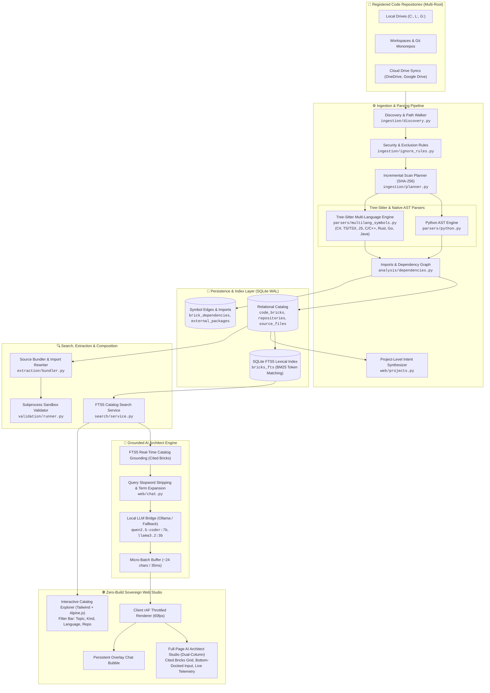
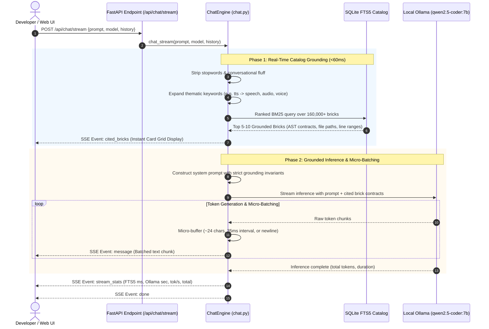

# BrickForge — System & Ingestion Architecture

> **Sovereign AST Code Intelligence, Multi-Language Component Registry & Grounded AI Agent Engine**

This document details the architectural specification, data storage model, multi-language AST extraction pipeline, hybrid search mechanics, and conversational RAG engine that power BrickForge.

---

## 1. System Overview & Component Topography



---

## 2. Ingestion Lifecycle & Incremental Delta Scanner

```text
register root
   -> enumerate candidate files
   -> apply security & ignore policies (.gitignore, build artifacts, db binaries)
   -> compute content SHA-256 fingerprint
   -> delta check: skip unchanged files (preserving existing symbol IDs)
   -> parse changed files (Python native AST or Tree-sitter grammar)
   -> extract AST symbol contracts, source spans, and docstrings
   -> resolve imports and construct symbol reference edges
   -> calculate static reuse signals (portability score, cyclomatic complexity)
   -> commit file + symbols + edges atomically in SQLite WAL transaction
   -> reconcile deleted or renamed files at scan conclusion
```

### 2.1 Root Registration and Discovery
A repository record represents an explicitly registered scan root. It may be a folder, Git working tree, mounted drive directory, or NAS path. Canonical paths are normalized using `safe_path_canonicalization` to prevent parent directory traversal (`../`) and unauthorized symlink escapes.

Default exclusions strictly filter out:
- Version-control internals (`.git`, `.svn`)
- Build outputs & compiler caches (`bin/`, `obj/`, `.vs/`, `Debug/`, `Release/`, `ipch/`, `dist/`, `build/`)
- Dependency caches (`node_modules/`, `.venv/`, `vendor/`, `packages/`)
- Database binaries & test caches (`*.db`, `*.sqlite`, `**/.pytest_cache/**`)
- Secret-bearing files (`.env`, `credentials.json`, `*.pem`, `*.key`)

### 2.2 Incremental Delta Scanner
For each candidate file:
1. Identify file by `(repository_id, normalized_relative_path)`.
2. Compute byte SHA-256, record size, modification time, and target language.
3. If the hash matches the database catalog and parser versions are unchanged, skip parsing entirely.
4. If modified, parse into an isolated temporary transaction. Existing symbol and dependency rows are replaced only when parsing succeeds.
5. If parsing encounters syntax errors, diagnostics are logged and previous good index state is retained by default.
6. Following a full scan run, files no longer present on disk are pruned from the catalog alongside their symbol rows and FTS5 entries.

---

## 3. Multi-Language AST & Tree-Sitter Parser Runtime

BrickForge uses a dual-engine parsing pipeline: native Python AST for deep Python semantics, and Tree-sitter grammars for high-throughput, error-tolerant parsing across non-Python ecosystems.

### 3.1 Supported Language Matrix

| Language | Primary Extensions | Engine | Extracted Symbol Kinds |
|---|---|---|---|
| **Python** | `.py` | `ast` (Python 3.10+) | `function`, `async function`, `class`, `method` |
| **C#** | `.cs` | Tree-sitter (`csharp`) | `class`, `interface`, `struct`, `enum`, `method`, `property` |
| **TypeScript / TSX** | `.ts`, `.tsx` | Tree-sitter (`typescript`, `tsx`) | `function`, `class`, `interface`, `type_alias`, `method` |
| **JavaScript / JSX** | `.js`, `.jsx`, `.mjs` | Tree-sitter (`javascript`) | `function`, `class`, `method` |
| **C / C++** | `.c`, `.cpp`, `.cc`, `.h`, `.hpp` | Tree-sitter (`c`, `cpp`) | `function`, `class`, `struct`, `enum`, `method` |
| **Rust** | `.rs` | Tree-sitter (`rust`) | `fn`, `struct`, `trait`, `enum`, `impl method` |
| **Go** | `.go` | Tree-sitter (`go`) | `func`, `method`, `struct`, `interface` |
| **Java** | `.java` | Tree-sitter (`java`) | `class`, `interface`, `method`, `enum` |

### 3.2 Symbol Contract Model
For every extracted symbol, BrickForge captures an immutable contract:
- **`brick_id`**: Deterministic SHA-256 derived from `repository_id + relative_path + qualified_name + kind + normalized_signature`.
- **Signatures**: Normalized parameter lists, return type annotations, visibility, and modifier flags (`async`, `generator`, `static`).
- **Source Span**: Precise start and end byte offsets and line numbers (`start_line`, `end_line`).
- **Documentation**: Cleaned docstrings and leading block comments.
- **Portability Score**: Deterministic heuristic in `[0.0, 1.0]` calculating self-containment based on dependency depth, internal vs external coupling, and platform dependencies.
- **Complexity**: Cyclomatic complexity metric calculated from branching and control-flow AST nodes.

---

## 4. Storage Architecture (SQLite WAL & FTS5)

BrickForge relies on a single-file, zero-maintenance SQLite database configured with Write-Ahead Logging (`PRAGMA journal_mode=WAL`), memory-mapped I/O, and foreign key enforcement.

```text
data/brickforge.db
├── repositories         (id, path, scan_policy, created_at, updated_at)
├── source_files         (id, repository_id, relative_path, content_hash, language, size)
├── code_bricks          (id, file_id, symbol_name, qualified_name, kind, language, signature,
│                         docstring, source_code, portability_score, complexity, start_line, end_line)
├── brick_dependencies   (id, source_brick_id, target_brick_id, unresolved_symbol, dep_type)
├── external_packages    (id, file_id, ecosystem, package_name, import_statement)
├── scan_runs            (id, repository_id, started_at, completed_at, files_scanned, errors)
└── bricks_fts           (FTS5 Virtual Table: symbol_name, qualified_name, signature, docstring, summary)
```

### 4.1 FTS5 Lexical Search Architecture
- `bricks_fts` is an external-content FTS5 virtual table backed by `code_bricks`.
- Synchronized via automatic `AFTER INSERT`, `AFTER UPDATE`, and `AFTER DELETE` triggers on `code_bricks`.
- Uses SQLite's BM25 ranking algorithm with column-weight tuning (`symbol_name` > `qualified_name` > `signature` > `docstring`).

---

## 5. Project-Level Aggregation (`kind=project`)

Beyond individual code symbols, BrickForge indexes macro-architectural components via project-level aggregation (`src/brickforge/web/projects.py`):
1. **Root & Directory Detection**: Scans directories containing build or package manifests (`pyproject.toml`, `package.json`, `Cargo.toml`, `*.csproj`, `CMakeLists.txt`, `go.mod`).
2. **Constituent Metrics**: Roll up total source files, total symbols, class counts, and method breakdowns per project.
3. **AI Intent Synthesis**: Synthesizes a high-level architectural purpose for the repository or project folder based on its top-level documentation, module signatures, and README context.
4. **Unified Catalog Visibility**: Projects are queryable alongside symbols with `kind=project` in the UI and CLI.

---

## 6. Grounded AI Architect Engine & Conversational RAG

The AI Architect engine (`src/brickforge/web/chat.py`) bridges local LLMs with the catalog, enabling developers to ask conversational questions about reusable components with guaranteed grounding.



### 6.1 Lexical Stopword Stripping & Thematic Query Expansion
Natural language queries often contain conversational padding ("*how can I convert efficiently markdown to pdf using my python scripts*").
- The engine strips grammatical stopwords and filler adverbs/adjectives (`efficiently`, `quickly`, `script`, `functions`, `used`, `please`).
- Extracts core technical stems (`markdown`, `pdf`, `convert`).
- Performs thematic expansions (e.g., `tts` expands to `tts`, `speech`, `audio`, `voice`, `synthesize`, `speaker`).
- Executes a dual-stage SQLite FTS5 query (strict exact conjunction, relaxing to ranked OR if matches are sparse).

### 6.2 High-Throughput Streaming & Micro-Batching
Direct character-by-character SSE streaming floods the browser network stack and triggers thousands of synchronous markdown parsing runs. BrickForge addresses this on both sides:
1. **Backend Micro-Buffering (`chat.py`)**: Emitted tokens are held in an in-memory accumulator and flushed when reaching 24 characters, elapsed time > 35 ms, or on newline (`\n`).
2. **Frontend `requestAnimationFrame` Throttling (`index.html`)**: The client buffers arriving SSE text and schedules DOM markdown updates via `requestAnimationFrame` on a 45 ms throttle window. This prevents browser thread lock and ensures fluid 60fps rendering.

### 6.3 Dual-View UX & Stream Persistence
- **Full-Page Studio Tab (`currentView === 'chat'`)**: 2-column layout with catalog stats, quick topic starters, 5-column responsive Cited Bricks card grid, and bottom-docked input bar (`tabChatInputArea`).
- **Floating Overlay Bubble (`currentView !== 'chat'`)**: Compact chat drawer that persists while exploring the catalog.
- **Uninterrupted View Transitions**: The streaming event listener is global to the Alpine.js component. Switching views between Catalog and AI Studio does **not** abort the background stream or drop response tokens.

### 6.4 Telemetry & Profiling
Every chat stream reports granular latency telemetry:
- `search_ms`: SQLite FTS5 candidate retrieval time (typically 30–70 ms over 160,000+ bricks).
- `ollama_sec`: Total LLM inference time.
- `tok_per_sec`: Generation throughput (e.g. `8.2 tok/s`).
- `total_sec`: End-to-end wall clock latency.

---

## 7. Extraction, Bundling & Validation Engine

When bricks are selected for composition or export:
1. **Dependency Traversal**: Traverses `brick_dependencies` recursively up to a configurable depth.
2. **Cycle Detection**: Builds a directed acyclic graph (DAG) and detects circular dependencies.
3. **Import Rewriting**: Rewrites local module paths into self-contained bundle imports without polluting global namespace.
4. **Manifest Generation**: Emits a `bundle_manifest.json` documenting constituent bricks, origin repository, exact file and line ranges, and external packaging requirements (`pip`, `npm`, `cargo`).
5. **Subprocess Validation**: Validates bundles in temporary isolated directories (`validation/runner.py`) by invoking native syntax checks (`python -m py_compile`) and test suites without executing unverified code in the primary host process.

---

## 8. Architectural Invariants

1. **Static Analysis Only**: Scanned code is **never imported or executed** during discovery, parsing, or cataloging.
2. **Filesystem Confinement**: All paths are canonicalized against registered repository roots; symlink traversal outside roots is rejected.
3. **Determinism**: Brick IDs and signatures are deterministic hashes; rescanning an identical repository produces zero database churn.
4. **Sovereignty**: BrickForge operates 100% locally with SQLite and local Ollama models; no proprietary code or embeddings leave the local machine.
