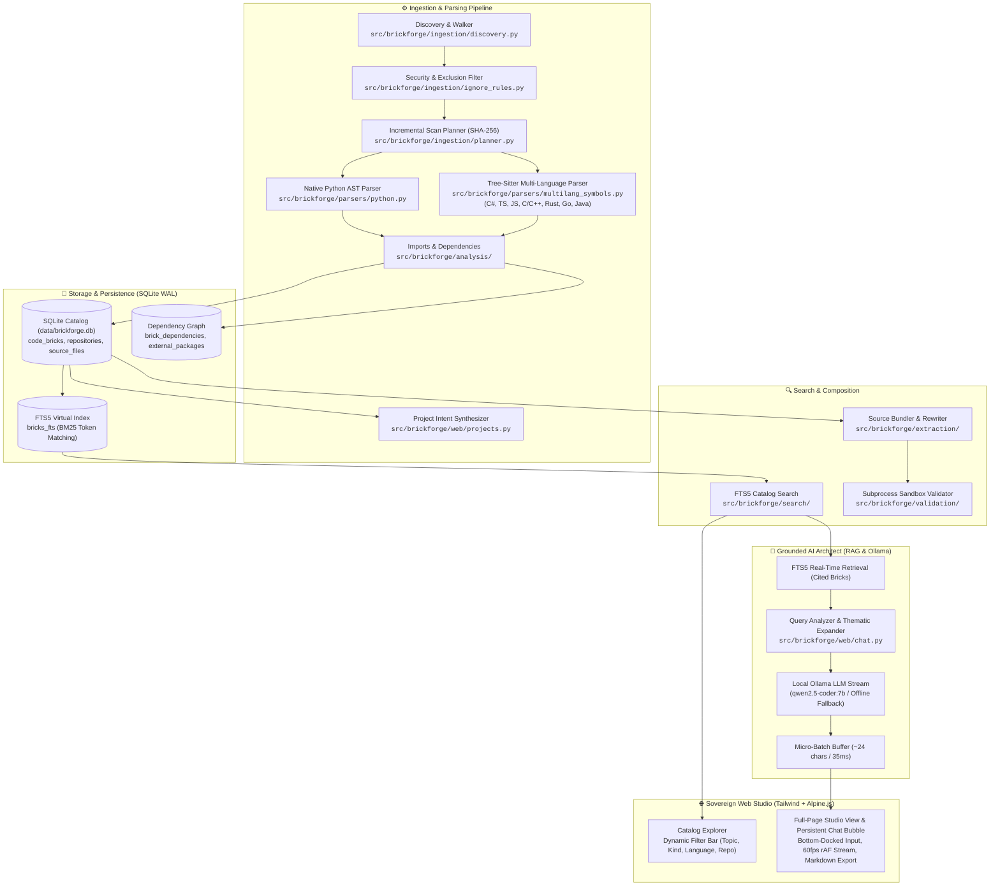
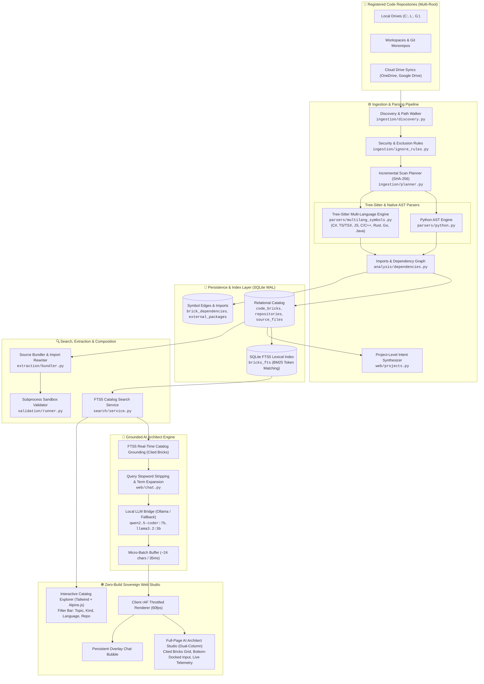
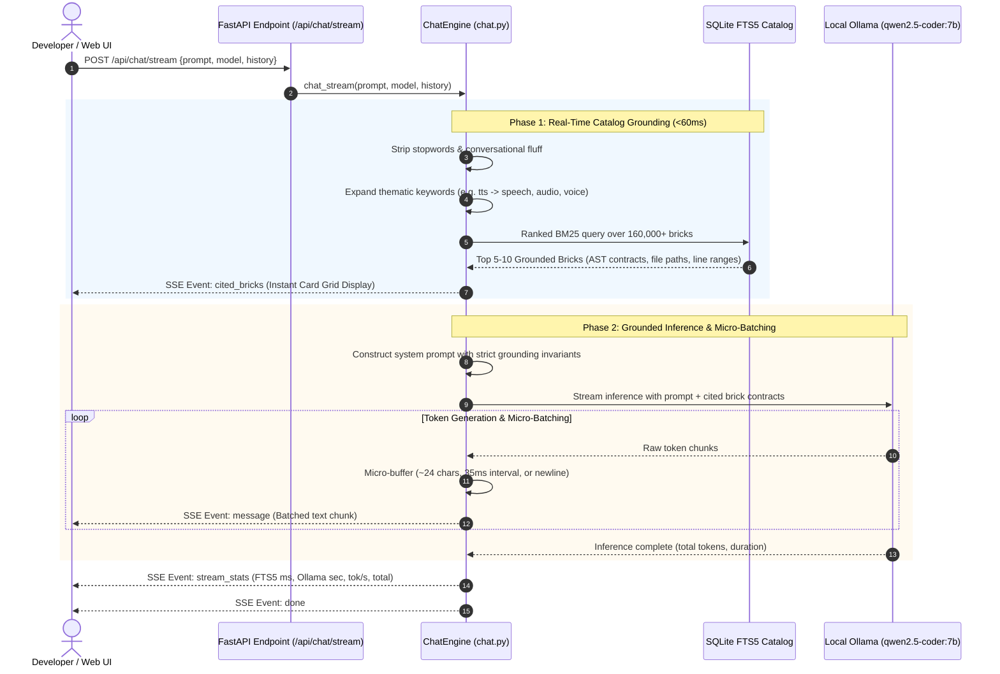
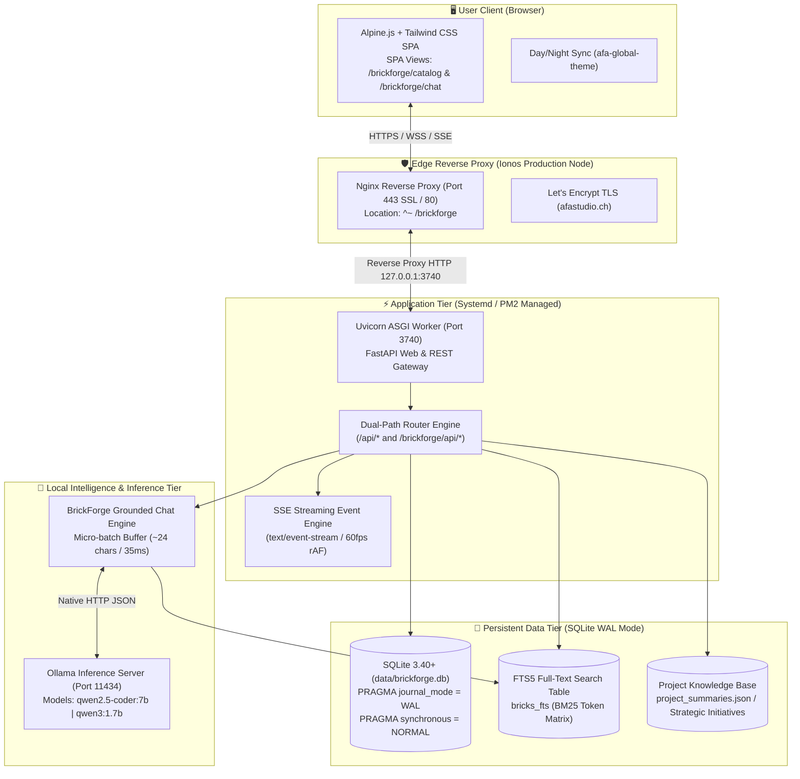
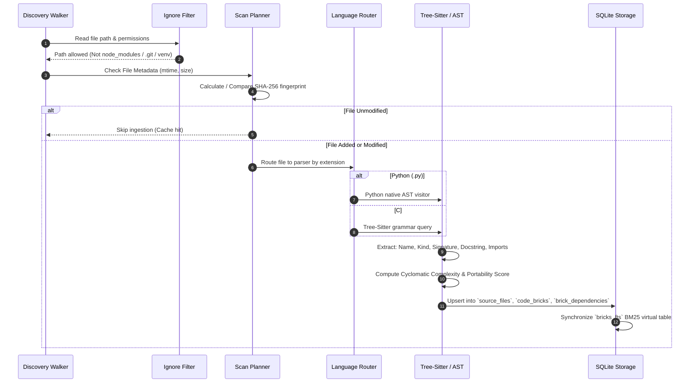
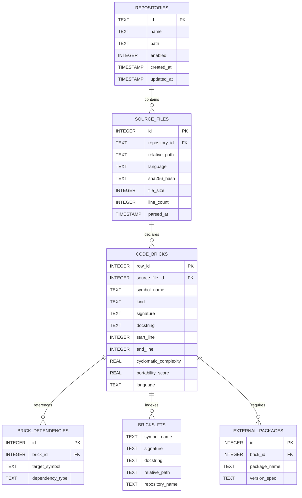
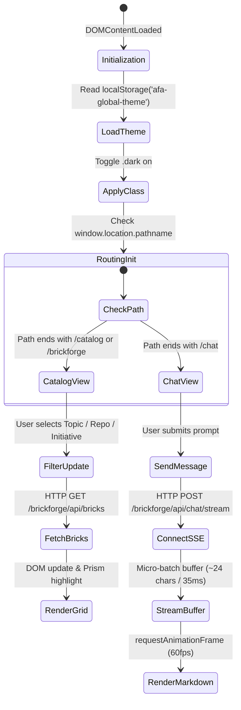

# BrickForge (`brickforge`)

> **Sovereign AST Code Intelligence & Composable Component Registry for AI Agents and Engineers.**

[](https://www.python.org/downloads/)
[](LICENSE)
[]()
[]()
[]()

---

## 🎯 Vision & Value Proposition

In modern software ecosystems, high-value code components, utility algorithms, schema models, and architectural patterns are scattered across local repositories, legacy drives, and monorepo silos. **BrickForge** transforms your local codebase into an autonomous, searchable component registry:

- **Indexes at Scale**: Statically parses and registers **160,000+ reusable code modules ("Bricks")** and **280+ projects** across local repositories into an authoritative SQLite database.
- **Multi-Language AST Extraction**: Native Python AST plus Tree-sitter grammars across **Python, C#, TypeScript/TSX, JavaScript, C/C++, Rust, Go, and Java**.
- **Extracts Clear Contracts**: Captures type-annotated signatures, docstrings, parameters, return types, cyclomatic complexity, and self-containment portability scores without running source code.
- **Project-Level Intelligence**: Aggregates multi-file directories into project-level entries (`kind=project`) with AI-synthesized architectural intent and metric rollups.
- **Grounded AI Architect**: Features a local, conversational assistant powered by local Ollama LLMs (`qwen2.5-coder:7b`, `llama3.2:3b`), grounded in real-time by SQLite FTS5 lexical BM25 retrieval.
- **Sovereign & Zero-Build**: Runs 100% locally with a zero-build Tailwind CSS + Alpine.js web studio, requiring no external cloud dependencies or telemetry.

---

## 🏛️ System Architecture



---

## 💻 Multi-Language Support Matrix

BrickForge parses source files using high-performance, error-tolerant parsers tailored to each language ecosystem:

| Language | Extensions | Parser Engine | Extracted Symbols |
|---|---|---|---|
| **Python** | `.py` | Native `ast` (Python 3.10+) | Functions, Async Functions, Classes, Methods |
| **C#** | `.cs` | Tree-sitter (`csharp`) | Classes, Interfaces, Structs, Enums, Methods, Properties |
| **TypeScript / TSX** | `.ts`, `.tsx` | Tree-sitter (`typescript`, `tsx`) | Functions, Classes, Interfaces, Type Aliases, Methods |
| **JavaScript / JSX** | `.js`, `.jsx`, `.mjs` | Tree-sitter (`javascript`) | Functions, Classes, Methods |
| **Rust** | `.rs` | Tree-sitter (`rust`) | Functions (`fn`), Structs, Traits, Enums, Impl Methods |
| **C / C++** | `.c`, `.cpp`, `.cc`, `.h`, `.hpp` | Tree-sitter (`c`, `cpp`) | Functions, Classes, Structs, Enums, Methods |
| **Go** | `.go` | Tree-sitter (`go`) | Functions (`func`), Methods, Structs, Interfaces |
| **Java** | `.java` | Tree-sitter (`java`) | Classes, Interfaces, Methods, Enums |

---

## 📂 Repository Layout

```text
c:\Dev\brickForge
├── config/                # Repository registration manifests
│   └── repositories.json  # Multi-root repository definitions & exclude globs
├── docs/                  # Architecture & operational specifications
│   ├── ARCHITECTURE.md    # In-depth system & RAG streaming architecture
│   ├── quickstart.md      # CLI, Python API, and database operations guide
│   └── security.md        # Static security boundaries and path canonicalization
├── scripts/               # Operational utility scripts
│   ├── serve_catalog.py   # One-click FastAPI web server launcher
│   └── sync_repositories.py # Multi-root incremental sync & indexer
├── src/brickforge/        # Primary Python source package
│   ├── analysis/          # Call graphs, dependencies, and symbol indexing
│   ├── composition/       # Composition models, adaptation service, and approval workflow
│   ├── extraction/        # Bundling, import rewriter, manifest, and output formatters
│   ├── ingestion/         # Discovery, fingerprints, path sanitization, and scan planner
│   ├── parsers/           # Python AST and Tree-Sitter multi-language runtime
│   ├── search/            # SQLite FTS5 search service and query models
│   ├── storage/           # SQLite migrations, WAL connection manager, and brick repository
│   ├── validation/        # Subprocess isolated test runners and syntax checking
│   └── web/               # FastAPI web server, AI Architect chat engine, and templates
│       ├── app.py         # REST & SSE API endpoints
│       ├── chat.py        # Conversational RAG engine, query expansion, and Ollama bridge
│       ├── projects.py    # Project aggregation, language detection, and intent synthesis
│       └── templates/     # Single-page sovereign web studio (index.html)
├── tests/                 # Automated test suite
│   ├── unit/              # Fast unit tests (chat engine, parsers, search, web API)
│   ├── integration/       # Database migrations, FTS5, and persistence integration
│   ├── e2e/               # End-to-end multi-root indexing and extraction
│   └── security/          # Path canonicalization and symlink security tests
└── pyproject.toml         # Packaging & dependency configuration
```

---

## 🚀 Quickstart

### 1. Installation

```bash
# Clone the repository
git clone https://github.com/titwan37/brickForge.git
cd brickForge

# Install package in editable development mode
python -m pip install -e .
```

Verify your installation:
```bash
python -m brickforge --help
```

---

### 2. Multi-Root Indexing & Repository Sync

Configure your repository roots in `config/repositories.json`, then run the incremental synchronizer:

```bash
# Register repositories and run an incremental delta scan
python scripts/sync_repositories.py

# Or scan a single repository root (e.g. dev-c)
python scripts/sync_repositories.py --repo dev-c

# Or force a complete re-index (bypassing the SHA-256 cache)
python scripts/sync_repositories.py --force
```

---

### 3. Launching the Sovereign Web Studio

Launch the interactive single-page Web Studio (opens automatically at [http://127.0.0.1:8000](http://127.0.0.1:8000)):

```bash
# Launch via convenience launcher script
python scripts/serve_catalog.py

# Or launch via the BrickForge CLI
python -m brickforge serve --port 8000
```

---

## 🎨 Web Studio & AI Architect Features

The BrickForge web interface is a zero-build, responsive single-page application built with Tailwind CSS, Alpine.js, Lucide Icons, Prism.js, and Marked.js:

### 1. Interactive Catalog Explorer
- **Thematic Sidebar**: Browse code categories with real-time counts (AI & Agents, Data & Storage, Web APIs, Testing & Quality, Security, Parsers & AST, Audio/DSP).
- **Dynamic Filter Bar**: Real-time chips reflecting `activeTopic`, `activeKind` (Functions, Classes, Methods, Projects), `activeLanguage` (Python, C#, TypeScript, Rust, C++, Go), and `activeRepo`.
- **Card Grid & Contract Drawer**: 3-column responsive card view displaying signature contracts, docstrings, cyclomatic complexity, and portability scores, with a slide-over code inspector.

### 2. Full-Page AI Architect Studio (`currentView === 'chat'`)
- **Expanded Dual-Column Workspace**: Grounded catalog telemetry on the left, conversation timeline on the right.
- **Bottom-Docked Input Bar**: `tabChatInputArea` stays firmly docked at the viewport base.
- **Instant Cited Code Bricks**: Top 5 candidate bricks appear instantly (<60ms) in an interactive card grid before LLM text streams.
- **Single Thinking Spinner**: Clean, unified spinner indicating background progress.

### 3. Persistent Floating Chat Bubble (`currentView !== 'chat'`)
- Chat with the catalog without leaving the catalog view.
- **Uninterrupted Stream Persistence**: Switching between Catalog view and Studio view preserves active SSE streams without dropping tokens or resetting history.

### 4. High-Performance Buffered Streaming
- **Backend Micro-Batching**: Chunks are batched (~24 characters, 35ms, or newline) to eliminate SSE flood.
- **Frontend 60fps Rendering**: Text is flushed via `requestAnimationFrame` on a 45ms throttle, eliminating browser thread stutter.

### 5. Live Telemetry & Export Tools
- **Live Latency Telemetry**: Displays Quick Cited Bricks FTS5 time (ms), Ollama generation time, tokens/second, and total latency.
- **1-Click Markdown Export**:
  - Single message: **Copy Markdown** to clipboard or **Export .md** to disk.
  - Entire session: **Copy All** to clipboard or **ChatHistory.md** download.
- **Keyboard Shortcuts**: `Ctrl+Enter` or `Enter` to submit prompt, `Shift+Enter` for multiline input.

---

## 🔍 CLI & Python API Usage

### Command Line Interface

```bash
# Initialize SQLite catalog
python -m brickforge init

# Scan a directory
python -m brickforge scan --repo-path /path/to/repo --repo-id my-repo

# Search for symbols using FTS5
python -m brickforge search "markdown to pdf"
```

### Python API

```python
from pathlib import Path
from brickforge.storage.database import DatabaseManager
from brickforge.search.service import CatalogSearchService, CatalogQuery

db_mgr = DatabaseManager(db_path=Path("data/brickforge.db"))
search = CatalogSearchService(db_mgr)

# Execute full-text lexical search
results = search.search(CatalogQuery(query="MarkdownToPdfConverter", limit=5))
for brick in results:
    print(f"[{brick.language}] {brick.symbol_name} ({brick.kind}) -> {brick.relative_path}")
```

---

## 📚 Technical Documentation & System Specifications

For enterprise audits, architecture reviews, and engineering blueprints, consult the formal design documents:

- **[Technical Architecture Document (TAD)](file:///C:/Dev/brickForge/docs/TAD_BrickForge.md)**: Physical topography, multi-language parser specifications, system BOM, network ingress, and RAG streaming buffer mechanics.
- **[Software Design Document (SDD)](file:///C:/Dev/brickForge/docs/SDD_BrickForge.md)**: SQLite entity relationships, schema definitions, module architecture, incremental scan algorithms, API endpoints contract, and testing matrix.
- **[Architectural Deep Dive](file:///C:/Dev/brickForge/docs/ARCHITECTURE2.md)**: In-depth ingestion walkthrough and component diagrams.
- **[Security Guarantees](file:///C:/Dev/brickForge/docs/security.md)**: Filesystem confinement, path traversal sanitization, and execution isolation policies.

---

## 🔒 Security Model

BrickForge operates under strict security boundaries:
1. **Zero Dynamic Execution**: Code is analyzed strictly through static AST and Tree-sitter parsers. It is never imported, evaluated, or executed during indexing.
2. **Filesystem Confinement**: Path traversal protection enforces `safe_path_canonicalization`, preventing `../` escapes and blocking symlinks that resolve outside registered roots.
3. **Sensitive File Blacklisting**: Built-in exclusions automatically reject credential files (`.env`, `*.pem`), build directories, and database binaries.
4. **Subprocess Isolation**: Bundle extraction tests execute in disposable sandboxes with enforced timeouts.

For complete security guarantees, see [docs/security.md](file:///C:/Dev/brickForge/docs/security.md).

---

## 🧪 Testing

Always execute tests using the Python module invocation:

```bash
# Run unit tests
python -m pytest tests/unit/

# Run web API & chat engine tests
python -m pytest tests/unit/test_chat_engine.py tests/unit/test_web_api.py

# Run full test suite
python -m pytest
```

---

## 📜 License

MIT License. Designed for sovereign, resilient software engineering.

---

# BrickForge — System & Ingestion Architecture

> **Sovereign AST Code Intelligence, Multi-Language Component Registry & Grounded AI Agent Engine**

This document details the architectural specification, data storage model, multi-language AST extraction pipeline, hybrid search mechanics, and conversational RAG engine that power BrickForge.

---

## 1. System Overview & Component Topography



---

## 2. Ingestion Lifecycle & Incremental Delta Scanner

```text
register root
   -> enumerate candidate files
   -> apply security & ignore policies (.gitignore, build artifacts, db binaries)
   -> compute content SHA-256 fingerprint
   -> delta check: skip unchanged files (preserving existing symbol IDs)
   -> parse changed files (Python native AST or Tree-sitter grammar)
   -> extract AST symbol contracts, source spans, and docstrings
   -> resolve imports and construct symbol reference edges
   -> calculate static reuse signals (portability score, cyclomatic complexity)
   -> commit file + symbols + edges atomically in SQLite WAL transaction
   -> reconcile deleted or renamed files at scan conclusion
```

### 2.1 Root Registration and Discovery
A repository record represents an explicitly registered scan root. It may be a folder, Git working tree, mounted drive directory, or NAS path. Canonical paths are normalized using `safe_path_canonicalization` to prevent parent directory traversal (`../`) and unauthorized symlink escapes.

Default exclusions strictly filter out:
- Version-control internals (`.git`, `.svn`)
- Build outputs & compiler caches (`bin/`, `obj/`, `.vs/`, `Debug/`, `Release/`, `ipch/`, `dist/`, `build/`)
- Dependency caches (`node_modules/`, `.venv/`, `vendor/`, `packages/`)
- Database binaries & test caches (`*.db`, `*.sqlite`, `**/.pytest_cache/**`)
- Secret-bearing files (`.env`, `credentials.json`, `*.pem`, `*.key`)

### 2.2 Incremental Delta Scanner
For each candidate file:
1. Identify file by `(repository_id, normalized_relative_path)`.
2. Compute byte SHA-256, record size, modification time, and target language.
3. If the hash matches the database catalog and parser versions are unchanged, skip parsing entirely.
4. If modified, parse into an isolated temporary transaction. Existing symbol and dependency rows are replaced only when parsing succeeds.
5. If parsing encounters syntax errors, diagnostics are logged and previous good index state is retained by default.
6. Following a full scan run, files no longer present on disk are pruned from the catalog alongside their symbol rows and FTS5 entries.

---

## 3. Multi-Language AST & Tree-Sitter Parser Runtime

BrickForge uses a dual-engine parsing pipeline: native Python AST for deep Python semantics, and Tree-sitter grammars for high-throughput, error-tolerant parsing across non-Python ecosystems.

### 3.1 Supported Language Matrix

| Language | Primary Extensions | Engine | Extracted Symbol Kinds |
|---|---|---|---|
| **Python** | `.py` | `ast` (Python 3.10+) | `function`, `async function`, `class`, `method` |
| **C#** | `.cs` | Tree-sitter (`csharp`) | `class`, `interface`, `struct`, `enum`, `method`, `property` |
| **TypeScript / TSX** | `.ts`, `.tsx` | Tree-sitter (`typescript`, `tsx`) | `function`, `class`, `interface`, `type_alias`, `method` |
| **JavaScript / JSX** | `.js`, `.jsx`, `.mjs` | Tree-sitter (`javascript`) | `function`, `class`, `method` |
| **C / C++** | `.c`, `.cpp`, `.cc`, `.h`, `.hpp` | Tree-sitter (`c`, `cpp`) | `function`, `class`, `struct`, `enum`, `method` |
| **Rust** | `.rs` | Tree-sitter (`rust`) | `fn`, `struct`, `trait`, `enum`, `impl method` |
| **Go** | `.go` | Tree-sitter (`go`) | `func`, `method`, `struct`, `interface` |
| **Java** | `.java` | Tree-sitter (`java`) | `class`, `interface`, `method`, `enum` |

### 3.2 Symbol Contract Model
For every extracted symbol, BrickForge captures an immutable contract:
- **`brick_id`**: Deterministic SHA-256 derived from `repository_id + relative_path + qualified_name + kind + normalized_signature`.
- **Signatures**: Normalized parameter lists, return type annotations, visibility, and modifier flags (`async`, `generator`, `static`).
- **Source Span**: Precise start and end byte offsets and line numbers (`start_line`, `end_line`).
- **Documentation**: Cleaned docstrings and leading block comments.
- **Portability Score**: Deterministic heuristic in `[0.0, 1.0]` calculating self-containment based on dependency depth, internal vs external coupling, and platform dependencies.
- **Complexity**: Cyclomatic complexity metric calculated from branching and control-flow AST nodes.

---

## 4. Storage Architecture (SQLite WAL & FTS5)

BrickForge relies on a single-file, zero-maintenance SQLite database configured with Write-Ahead Logging (`PRAGMA journal_mode=WAL`), memory-mapped I/O, and foreign key enforcement.

```text
data/brickforge.db
├── repositories         (id, path, scan_policy, created_at, updated_at)
├── source_files         (id, repository_id, relative_path, content_hash, language, size)
├── code_bricks          (id, file_id, symbol_name, qualified_name, kind, language, signature,
│                         docstring, source_code, portability_score, complexity, start_line, end_line)
├── brick_dependencies   (id, source_brick_id, target_brick_id, unresolved_symbol, dep_type)
├── external_packages    (id, file_id, ecosystem, package_name, import_statement)
├── scan_runs            (id, repository_id, started_at, completed_at, files_scanned, errors)
└── bricks_fts           (FTS5 Virtual Table: symbol_name, qualified_name, signature, docstring, summary)
```

### 4.1 FTS5 Lexical Search Architecture
- `bricks_fts` is an external-content FTS5 virtual table backed by `code_bricks`.
- Synchronized via automatic `AFTER INSERT`, `AFTER UPDATE`, and `AFTER DELETE` triggers on `code_bricks`.
- Uses SQLite's BM25 ranking algorithm with column-weight tuning (`symbol_name` > `qualified_name` > `signature` > `docstring`).

---

## 5. Project-Level Aggregation (`kind=project`)

Beyond individual code symbols, BrickForge indexes macro-architectural components via project-level aggregation (`src/brickforge/web/projects.py`):
1. **Root & Directory Detection**: Scans directories containing build or package manifests (`pyproject.toml`, `package.json`, `Cargo.toml`, `*.csproj`, `CMakeLists.txt`, `go.mod`).
2. **Constituent Metrics**: Roll up total source files, total symbols, class counts, and method breakdowns per project.
3. **AI Intent Synthesis**: Synthesizes a high-level architectural purpose for the repository or project folder based on its top-level documentation, module signatures, and README context.
4. **Unified Catalog Visibility**: Projects are queryable alongside symbols with `kind=project` in the UI and CLI.

---

## 6. Grounded AI Architect Engine & Conversational RAG

The AI Architect engine (`src/brickforge/web/chat.py`) bridges local LLMs with the catalog, enabling developers to ask conversational questions about reusable components with guaranteed grounding.



### 6.1 Lexical Stopword Stripping & Thematic Query Expansion
Natural language queries often contain conversational padding ("*how can I convert efficiently markdown to pdf using my python scripts*").
- The engine strips grammatical stopwords and filler adverbs/adjectives (`efficiently`, `quickly`, `script`, `functions`, `used`, `please`).
- Extracts core technical stems (`markdown`, `pdf`, `convert`).
- Performs thematic expansions (e.g., `tts` expands to `tts`, `speech`, `audio`, `voice`, `synthesize`, `speaker`).
- Executes a dual-stage SQLite FTS5 query (strict exact conjunction, relaxing to ranked OR if matches are sparse).

### 6.2 High-Throughput Streaming & Micro-Batching
Direct character-by-character SSE streaming floods the browser network stack and triggers thousands of synchronous markdown parsing runs. BrickForge addresses this on both sides:
1. **Backend Micro-Buffering (`chat.py`)**: Emitted tokens are held in an in-memory accumulator and flushed when reaching 24 characters, elapsed time > 35 ms, or on newline (`\n`).
2. **Frontend `requestAnimationFrame` Throttling (`index.html`)**: The client buffers arriving SSE text and schedules DOM markdown updates via `requestAnimationFrame` on a 45 ms throttle window. This prevents browser thread lock and ensures fluid 60fps rendering.

### 6.3 Dual-View UX & Stream Persistence
- **Full-Page Studio Tab (`currentView === 'chat'`)**: 2-column layout with catalog stats, quick topic starters, 5-column responsive Cited Bricks card grid, and bottom-docked input bar (`tabChatInputArea`).
- **Floating Overlay Bubble (`currentView !== 'chat'`)**: Compact chat drawer that persists while exploring the catalog.
- **Uninterrupted View Transitions**: The streaming event listener is global to the Alpine.js component. Switching views between Catalog and AI Studio does **not** abort the background stream or drop response tokens.

### 6.4 Telemetry & Profiling
Every chat stream reports granular latency telemetry:
- `search_ms`: SQLite FTS5 candidate retrieval time (typically 30–70 ms over 160,000+ bricks).
- `ollama_sec`: Total LLM inference time.
- `tok_per_sec`: Generation throughput (e.g. `8.2 tok/s`).
- `total_sec`: End-to-end wall clock latency.

---

## 7. Extraction, Bundling & Validation Engine

When bricks are selected for composition or export:
1. **Dependency Traversal**: Traverses `brick_dependencies` recursively up to a configurable depth.
2. **Cycle Detection**: Builds a directed acyclic graph (DAG) and detects circular dependencies.
3. **Import Rewriting**: Rewrites local module paths into self-contained bundle imports without polluting global namespace.
4. **Manifest Generation**: Emits a `bundle_manifest.json` documenting constituent bricks, origin repository, exact file and line ranges, and external packaging requirements (`pip`, `npm`, `cargo`).
5. **Subprocess Validation**: Validates bundles in temporary isolated directories (`validation/runner.py`) by invoking native syntax checks (`python -m py_compile`) and test suites without executing unverified code in the primary host process.

---

## 8. Architectural Invariants

1. **Static Analysis Only**: Scanned code is **never imported or executed** during discovery, parsing, or cataloging.
2. **Filesystem Confinement**: All paths are canonicalized against registered repository roots; symlink traversal outside roots is rejected.
3. **Determinism**: Brick IDs and signatures are deterministic hashes; rescanning an identical repository produces zero database churn.
4. **Sovereignty**: BrickForge operates 100% locally with SQLite and local Ollama models; no proprietary code or embeddings leave the local machine.

---

# Technical Architecture Document (TAD) — BrickForge

**System Name:** BrickForge (`brickforge`)  
**Version:** 1.0.0 (Production Ready)  
**Author / Organization:** AFA Studio / Autonomous Agentic Systems  
**Date:** November 2026  
**Status:** Approved / Active Production  

---

## 1. Executive Summary & Architectural Goals

**BrickForge** is a sovereign, offline-first AST code intelligence engine and composable component registry. It transforms multi-repository local file systems and monorepos into an indexed, queryable software catalog containing **160,000+ reusable code modules ("Bricks")** and **280+ architectural projects** spanning 8 programming languages.

### Core Architecture Pillars

1. **Sovereignty & Offline Operation**: Zero reliance on third-party SaaS vector databases or closed-source cloud APIs. Ingestion, SQLite indexing, and LLM inference (via local Ollama) run entirely on local or self-hosted bare-metal nodes.
2. **Deterministic Contract Extraction**: Parsing is non-destructive and static (no code execution during discovery). It extracts strict type signatures, interfaces, dependencies, docstrings, and compute portability scores.
3. **Lexical Precision with FTS5 BM25**: Employs SQLite FTS5 full-text search with tokenized BM25 ranking for exact symbol, syntax, and keyword retrieval without embedding vector drift.
4. **Sub-second Hybrid Ingress & Zero-Build Frontend**: Single-bundle, zero-npm frontend architecture powered by Tailwind CSS and Alpine.js, reverse-proxied through Nginx with SSE streaming.

---

## 2. System Topography & Physical Architecture

The solution deploys across two runtime modes: **Standalone Local Developer Mode** and **Enterprise Self-Hosted Production Node (Ionos Cloud / Nginx)**.



---

## 3. Technology Stack & Component Bill of Materials

| Layer | Component | Version / Spec | Justification & Role |
|---|---|---|---|
| **Language Runtime** | Python | 3.10 – 3.14 (3.12 target) | Multi-core multiprocessing AST parsing, native sqlite3 integration. |
| **API Framework** | FastAPI | 0.115+ | High-throughput asynchronous REST & Server-Sent Events (SSE) streaming. |
| **ASGI Server** | Uvicorn | 0.30+ | Standard asynchronous worker with process supervisor support. |
| **Storage Engine** | SQLite3 + FTS5 | SQLite 3.40+ | Sovereign, single-file ACID persistence; zero-maintenance WAL mode. |
| **AST Parser (Python)**| `ast` standard library | Native Python | Fault-tolerant, recursive AST visitor for functions, classes, and decorators. |
| **AST Parser (Multi-Lang)** | Tree-sitter | `tree-sitter>=0.21.3` | Incremental AST parsing for C#, TypeScript, JavaScript, Rust, C++, Go, Java. |
| **Local LLM Engine** | Ollama | 0.3+ | Local, private LLM execution without external network egress. |
| **Frontend Framework**| Alpine.js + Tailwind CDN | Alpine 3.14.8 | Zero-build, static asset frontend; reactive state without Node.js toolchains. |
| **Reverse Proxy** | Nginx | 1.24+ (Ubuntu) | SSL termination, HTTP/2 multiplexing, SSE buffer unbuffering (`X-Accel-Buffering`). |
| **Process Manager** | PM2 | 5.3+ | Daemon management, zero-downtime reloads, memory guardrails (`1000M`). |

---

## 4. Multi-Language AST Extraction Engine

BrickForge eliminates multi-language parsing divergence by standardizing extracted entities into a uniform AST model:



### Supported Language Grammars

1. **Python**: Native `ast` module extracting top-level and inner classes, async/sync functions, class methods, decorators, type hints, and docstrings.
2. **TypeScript & TSX**: Tree-sitter `tree_sitter_typescript` for interfaces, type aliases, classes, exported arrow functions, and React functional components.
3. **C# (.NET)**: Tree-sitter `tree_sitter_c_sharp` capturing namespaces, classes, structs, records, interfaces, properties, and methods.
4. **Rust**: Tree-sitter `tree_sitter_rust` capturing `struct`, `enum`, `trait`, `impl` blocks, and `fn` functions.
5. **C / C++**: Tree-sitter `tree_sitter_cpp` identifying structs, classes, templates, and function declarations.
6. **Go**: Tree-sitter `tree_sitter_go` capturing package declarations, structs, interfaces, and methods.
7. **Java**: Tree-sitter `tree_sitter_java` capturing classes, interfaces, records, and method signatures.

---

## 5. Grounded RAG & AI Architect Studio Architecture

BrickForge integrates a conversational RAG engine that guarantees LLM responses cite real code in your repositories:

```mermaid
flowchart LR
    subgraph QueryPipeline["1. Query Analysis"]
        UserPrompt["User Chat Message"] --> StopwordStrip["Stopword Stripping & Stemming"]
        StopwordStrip --> Expand["Term Expansion (TTS, DB, Auth, PDF)"]
    end

    subgraph RetrievalEngine["2. Catalog Grounding (FTS5)"]
        Expand --> FTSMatch["FTS5 MATCH (Query Tokens)"]
        FTSMatch --> BM25Rank["BM25 Ranking & Portability Weight"]
        BM25Rank --> CitedBricks["Top 5 High-Value Cited Bricks"]
    end

    subgraph SynthesisEngine["3. LLM Prompt Construction"]
        CitedBricks --> SystemPrompt["Grounded System Instructions<br/>(Injects Signatures, Paths, Contracts)"]
        UserPrompt --> SystemPrompt
        SystemPrompt --> OllamaStream["Ollama HTTP Stream (/api/chat)"]
    end

    subgraph ClientDelivery["4. Micro-Batched Streaming"]
        OllamaStream --> MicroBuffer["SSE Micro-Batcher (~24 chars / 35ms)"]
        MicroBuffer --> WebhookSSE["text/event-stream"]
        WebhookSSE --> BrowserRAF["Browser requestAnimationFrame Render"]
    end
```



---

## 6. Security & Infrastructure Guardrails

1. **Static Analysis Only**: No dynamic code imports (`__import__` or `eval`), eliminating arbitrary code execution during indexing.
2. **Filesystem Isolation**: Path resolution verifies that indexed files remain within registered repository roots; directory traversal attempts (`../`) are blocked.
3. **External Package Boundary**: Distinguishes between local intra-repo dependencies and unverified external PyPI/npm packages.
4. **Sandboxed Subprocess Validator**: When validating bundle extractions (`brickforge test`), executions run in isolated temporary subdirectories with strict timeout limits (10s maximum).
5. **Network Ingress Protection**: Bound locally to `127.0.0.1:3740`; external access is strictly routed through Nginx reverse proxy with TLS encryption, HSTS, and rate limiting.

---

# Software Design Document (SDD) — BrickForge

**System Name:** BrickForge (`brickforge`)  
**Version:** 1.0.0 (Production Implementation)  
**Author / Organization:** AFA Studio / Autonomous Agentic Systems  
**Date:** November 2026  
**Document Reference:** SDD-BF-2026-V1  

---

## 1. Introduction & System Context

This Software Design Document (SDD) details the low-level module architectures, database schemas, API contracts, algorithmic flows, and interface designs of **BrickForge**.

---

## 2. Database Design & Persistence Schema

BrickForge persists all AST code intelligence inside SQLite 3 using WAL (Write-Ahead Logging) mode, enabling concurrent reads during heavy ingestion sweeps.

### 2.1 Entity Relationship Diagram



### 2.2 Table Definitions & Indexes

1. **`repositories`**: Registered scan roots (e.g. `c:\Dev\hub`, `c:\Dev\brickForge`).
2. **`source_files`**: File metadata, file system fingerprints (`sha256_hash`, `mtime`), and parsing status.
3. **`code_bricks`**: AST extracted symbols (`kind`: `function`, `class`, `method`, `project`, `interface`).
4. **`bricks_fts`**: SQLite FTS5 Virtual Table using the standard Unicode61 tokenizer with prefix indexing (`prefix='2,3,4'`) for real-time sub-word matching.
5. **`brick_dependencies`**: Intra-repository and inter-module call graph edges (`target_symbol`, `dependency_type`: `import`, `call`, `inheritance`).

---

## 3. Module Architecture & Package Structure

```
src/brickforge/
├── cli.py                     # Click/Typer CLI entrypoint
├── config.py                  # Environment & Path configurations
├── identity.py                # Deterministic Brick UUID & SHA-256 generator
├── contracts.py               # Data models (BrickContract, DependencyGraph)
├── ingestion/
│   ├── discovery.py           # Multi-root repository file walker
│   ├── ignore_rules.py        # Path security & exclusion filter
│   ├── paths.py               # Path normalization & safe relativization
│   ├── planner.py             # Incremental SHA-256 scan planner
│   └── pipeline.py            # Orchestrator coordinating AST parsing
├── parsers/
│   ├── base.py                # BaseParser interface
│   ├── python.py              # Native Python ast.NodeVisitor
│   ├── python_symbols.py      # Python symbol extractor
│   ├── multilang_symbols.py   # Tree-Sitter grammar query engine
│   └── tree_sitter_runtime.py # Dynamic library loader for Tree-sitter
├── search/
│   ├── fts.py                 # SQLite FTS5 query builder & BM25 ranker
│   └── service.py             # Hybrid search service with topic faceting
├── extraction/
│   ├── bundler.py             # Self-contained code bundle extractor
│   ├── import_rewriter.py     # AST-based import rewriting for extracted bundles
│   └── manifest.py            # Output manifest generator (brick.json)
├── validation/
│   ├── runner.py              # Subprocess test execution sandbox
│   └── python_checks.py       # Syntax and isolation verification
└── web/
    ├── app.py                 # FastAPI application & route definitions
    ├── chat.py                # Grounded RAG Chat Engine & Ollama client
    ├── projects.py            # Project rollup & metadata aggregator
    ├── initiatives.py         # Strategic Domain & Initiative taxonomy
    └── templates/
        └── index.html         # Sovereign SPA frontend (Tailwind + Alpine.js)
```

---

## 4. Key Component Designs & Algorithms

### 4.1 Incremental Scan Planning Algorithm (`planner.py`)

To prevent re-indexing 160,000+ files on every run, BrickForge executes an incremental three-phase planning algorithm:

```python
def compute_scan_plan(db_files: Dict[str, FileRecord], disk_files: List[Path]) -> ScanPlan:
    plan = ScanPlan()
    for file_path in disk_files:
        rel_path = normalize_path(file_path)
        stat = file_path.stat()
        
        # 1. Quick mtime and file size check
        if rel_path in db_files:
            cached = db_files[rel_path]
            if cached.mtime == stat.st_mtime and cached.file_size == stat.st_size:
                plan.unchanged.append(rel_path)
                continue
                
            # 2. Cryptographic content hash check if mtime changed
            new_hash = sha256_file(file_path)
            if new_hash == cached.sha256_hash:
                plan.unchanged.append(rel_path)
                continue
                
            plan.modified.append(PlannedAction(path=file_path, sha256=new_hash))
        else:
            plan.added.append(PlannedAction(path=file_path, sha256=sha256_file(file_path)))
            
    # 3. Detect deleted files
    disk_set = {normalize_path(p) for p in disk_files}
    plan.deleted = [p for p in db_files.keys() if p not in disk_set]
    return plan
```

### 4.2 Portability Scoring Algorithm (`python_symbols.py`)

Every code brick receives a portability score from `0.0` to `1.0` evaluating how easily it can be reused in another project without pulling dependencies:

$$\text{Portability} = 1.0 - (0.25 \times N_{\text{ext}} + 0.15 \times N_{\text{local}} + 0.05 \times \text{ComplexityPenalty})$$

Where:
- $N_{\text{ext}}$ is the number of third-party external imports (e.g., `pandas`, `torch`).
- $N_{\text{local}}$ is the number of project-internal relative imports (e.g., `from .utils import helper`).
- $\text{ComplexityPenalty} = \max(0, \frac{\text{CyclomaticComplexity} - 10}{20})$.

---

## 5. Web API Interface Contract

All endpoints support dual route prefixes: standalone `/api/...` and production proxy `/brickforge/api/...`.

| Method | Route Path | Description | Query / Body Parameters | Response Model |
|---|---|---|---|---|
| `GET` | `/catalog`, `/brickforge/catalog` | Render Web Catalog SPA | None | `text/html` |
| `GET` | `/chat`, `/brickforge/chat` | Render AI Architect Studio SPA | None | `text/html` |
| `GET` | `/api/stats`, `/brickforge/api/stats` | Global catalog metrics | None | `StatsResponse` |
| `GET` | `/api/categories`, `/brickforge/api/categories` | Facets: topics, languages, repos | None | `CategoriesResponse` |
| `GET` | `/api/initiatives`, `/brickforge/api/initiatives` | Strategic domain initiatives | None | `List[Initiative]` |
| `GET` | `/api/initiative/{id}` | Detail of strategic initiative | `id` (path) | `InitiativeDetail` |
| `GET` | `/api/bricks`, `/brickforge/api/bricks` | Search catalog with filters | `query`, `topic`, `kind`, `repo`, `language`, `page`, `page_size` | `PaginatedBricks` |
| `GET` | `/api/bricks/export` | JSON export of filtered catalog | Same as `/api/bricks`, `limit` (max 5000) | `ExportCatalogJSON` |
| `GET` | `/api/brick/{brick_id}` | Detailed brick source & contract | `brick_id` (int or `project:repo:name`) | `BrickDetail` |
| `GET` | `/api/chat/models` | Available Ollama LLMs | None | `ModelsResponse` |
| `POST` | `/api/chat` | Synchronous chat turn | `ChatRequest` (`message`, `history`, `model`) | `ChatResponse` |
| `POST` | `/api/chat/stream` | Real-time SSE token stream | `ChatRequest` (`message`, `history`, `model`) | `text/event-stream` |

---

## 6. Frontend State Management & Day/Night Theme System

The frontend in [`src/brickforge/web/templates/index.html`](file:///c:/Dev/brickForge/src/brickforge/web/templates/index.html) is an event-driven Alpine.js single-page application:



---

## 7. Verification & Operational Testing Matrix

| Test Suite | File Location | Scope | Verification Command |
|---|---|---|---|
| **Web API Unit Suite** | `tests/unit/test_web_api.py` | API routes, filters, project rollups, initiative facets, exports | `python -m pytest brickForge/tests/unit/test_web_api.py` |
| **Chat & RAG Engine** | `tests/unit/test_chat_engine.py`| BM25 stopword stripping, citation retrieval, prompt synthesis, fallback report | `python -m pytest brickForge/tests/unit/test_chat_engine.py` |
| **Multi-Lang Symbols** | `tests/unit/test_multilang_symbols.py` | Tree-Sitter grammar extraction for C#, TS, Rust, Go, C++ | `python -m pytest brickForge/tests/unit/test_multilang_symbols.py` |
| **Ingestion Pipeline** | `tests/unit/test_discovery.py` | Walker boundaries, ignore rules, scan planning | `python -m pytest brickForge/tests/unit/test_discovery.py` |
| **End-to-End Ingress** | `hub/tests/test_redirect.ps1` | Production URL routing, HTTP statuses, redirect loops, and API availability | `powershell -File hub/tests/test_redirect.ps1` |

