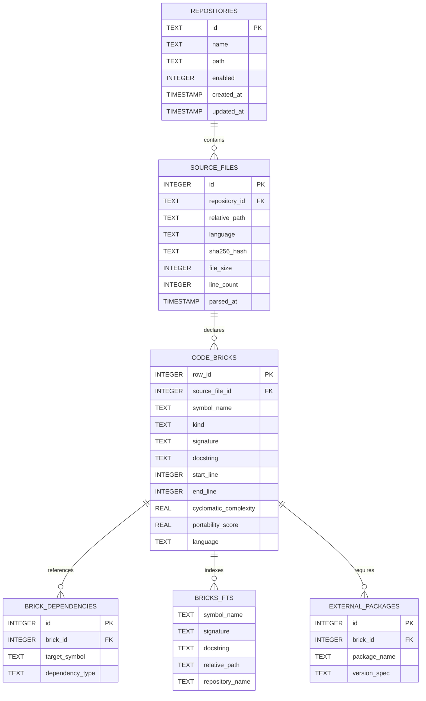
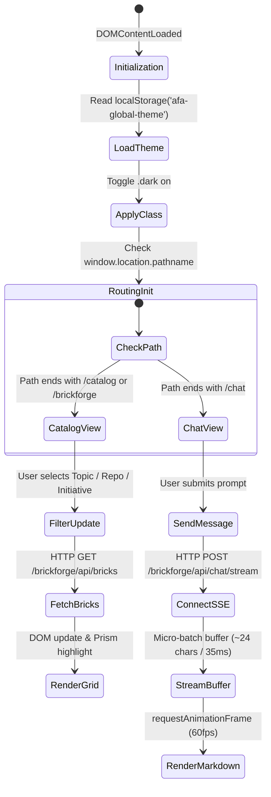

# Software Design Document (SDD) — BrickForge

**System Name:** BrickForge (`brickforge`)  
**Version:** 1.0.0 (Production Implementation)  
**Author / Organization:** AFA Studio / Autonomous Agentic Systems  
**Date:** November 2026  
**Document Reference:** SDD-BF-2026-V1  

---

## 1. Introduction & System Context

This Software Design Document (SDD) details the low-level module architectures, database schemas, API contracts, algorithmic flows, and interface designs of **BrickForge**.

---

## 2. Database Design & Persistence Schema

BrickForge persists all AST code intelligence inside SQLite 3 using WAL (Write-Ahead Logging) mode, enabling concurrent reads during heavy ingestion sweeps.

### 2.1 Entity Relationship Diagram



### 2.2 Table Definitions & Indexes

1. **`repositories`**: Registered scan roots (e.g. `c:\Dev\hub`, `c:\Dev\brickForge`).
2. **`source_files`**: File metadata, file system fingerprints (`sha256_hash`, `mtime`), and parsing status.
3. **`code_bricks`**: AST extracted symbols (`kind`: `function`, `class`, `method`, `project`, `interface`).
4. **`bricks_fts`**: SQLite FTS5 Virtual Table using the standard Unicode61 tokenizer with prefix indexing (`prefix='2,3,4'`) for real-time sub-word matching.
5. **`brick_dependencies`**: Intra-repository and inter-module call graph edges (`target_symbol`, `dependency_type`: `import`, `call`, `inheritance`).

---

## 3. Module Architecture & Package Structure

```
src/brickforge/
├── cli.py                     # Click/Typer CLI entrypoint
├── config.py                  # Environment & Path configurations
├── identity.py                # Deterministic Brick UUID & SHA-256 generator
├── contracts.py               # Data models (BrickContract, DependencyGraph)
├── ingestion/
│   ├── discovery.py           # Multi-root repository file walker
│   ├── ignore_rules.py        # Path security & exclusion filter
│   ├── paths.py               # Path normalization & safe relativization
│   ├── planner.py             # Incremental SHA-256 scan planner
│   └── pipeline.py            # Orchestrator coordinating AST parsing
├── parsers/
│   ├── base.py                # BaseParser interface
│   ├── python.py              # Native Python ast.NodeVisitor
│   ├── python_symbols.py      # Python symbol extractor
│   ├── multilang_symbols.py   # Tree-Sitter grammar query engine
│   └── tree_sitter_runtime.py # Dynamic library loader for Tree-sitter
├── search/
│   ├── fts.py                 # SQLite FTS5 query builder & BM25 ranker
│   └── service.py             # Hybrid search service with topic faceting
├── extraction/
│   ├── bundler.py             # Self-contained code bundle extractor
│   ├── import_rewriter.py     # AST-based import rewriting for extracted bundles
│   └── manifest.py            # Output manifest generator (brick.json)
├── validation/
│   ├── runner.py              # Subprocess test execution sandbox
│   └── python_checks.py       # Syntax and isolation verification
└── web/
    ├── app.py                 # FastAPI application & route definitions
    ├── chat.py                # Grounded RAG Chat Engine & Ollama client
    ├── projects.py            # Project rollup & metadata aggregator
    ├── initiatives.py         # Strategic Domain & Initiative taxonomy
    └── templates/
        └── index.html         # Sovereign SPA frontend (Tailwind + Alpine.js)
```

---

## 4. Key Component Designs & Algorithms

### 4.1 Incremental Scan Planning Algorithm (`planner.py`)

To prevent re-indexing 160,000+ files on every run, BrickForge executes an incremental three-phase planning algorithm:

```python
def compute_scan_plan(db_files: Dict[str, FileRecord], disk_files: List[Path]) -> ScanPlan:
    plan = ScanPlan()
    for file_path in disk_files:
        rel_path = normalize_path(file_path)
        stat = file_path.stat()
        
        # 1. Quick mtime and file size check
        if rel_path in db_files:
            cached = db_files[rel_path]
            if cached.mtime == stat.st_mtime and cached.file_size == stat.st_size:
                plan.unchanged.append(rel_path)
                continue
                
            # 2. Cryptographic content hash check if mtime changed
            new_hash = sha256_file(file_path)
            if new_hash == cached.sha256_hash:
                plan.unchanged.append(rel_path)
                continue
                
            plan.modified.append(PlannedAction(path=file_path, sha256=new_hash))
        else:
            plan.added.append(PlannedAction(path=file_path, sha256=sha256_file(file_path)))
            
    # 3. Detect deleted files
    disk_set = {normalize_path(p) for p in disk_files}
    plan.deleted = [p for p in db_files.keys() if p not in disk_set]
    return plan
```

### 4.2 Portability Scoring Algorithm (`python_symbols.py`)

Every code brick receives a portability score from `0.0` to `1.0` evaluating how easily it can be reused in another project without pulling dependencies:

$$\text{Portability} = 1.0 - (0.25 \times N_{\text{ext}} + 0.15 \times N_{\text{local}} + 0.05 \times \text{ComplexityPenalty})$$

Where:
- $N_{\text{ext}}$ is the number of third-party external imports (e.g., `pandas`, `torch`).
- $N_{\text{local}}$ is the number of project-internal relative imports (e.g., `from .utils import helper`).
- $\text{ComplexityPenalty} = \max(0, \frac{\text{CyclomaticComplexity} - 10}{20})$.

---

## 5. Web API Interface Contract

All endpoints support dual route prefixes: standalone `/api/...` and production proxy `/brickforge/api/...`.

| Method | Route Path | Description | Query / Body Parameters | Response Model |
|---|---|---|---|---|
| `GET` | `/catalog`, `/brickforge/catalog` | Render Web Catalog SPA | None | `text/html` |
| `GET` | `/chat`, `/brickforge/chat` | Render AI Architect Studio SPA | None | `text/html` |
| `GET` | `/api/stats`, `/brickforge/api/stats` | Global catalog metrics | None | `StatsResponse` |
| `GET` | `/api/categories`, `/brickforge/api/categories` | Facets: topics, languages, repos | None | `CategoriesResponse` |
| `GET` | `/api/initiatives`, `/brickforge/api/initiatives` | Strategic domain initiatives | None | `List[Initiative]` |
| `GET` | `/api/initiative/{id}` | Detail of strategic initiative | `id` (path) | `InitiativeDetail` |
| `GET` | `/api/bricks`, `/brickforge/api/bricks` | Search catalog with filters | `query`, `topic`, `kind`, `repo`, `language`, `page`, `page_size` | `PaginatedBricks` |
| `GET` | `/api/bricks/export` | JSON export of filtered catalog | Same as `/api/bricks`, `limit` (max 5000) | `ExportCatalogJSON` |
| `GET` | `/api/brick/{brick_id}` | Detailed brick source & contract | `brick_id` (int or `project:repo:name`) | `BrickDetail` |
| `GET` | `/api/chat/models` | Available Ollama LLMs | None | `ModelsResponse` |
| `POST` | `/api/chat` | Synchronous chat turn | `ChatRequest` (`message`, `history`, `model`) | `ChatResponse` |
| `POST` | `/api/chat/stream` | Real-time SSE token stream | `ChatRequest` (`message`, `history`, `model`) | `text/event-stream` |

---

## 6. Frontend State Management & Day/Night Theme System

The frontend in [`src/brickforge/web/templates/index.html`](file:///c:/Dev/brickForge/src/brickforge/web/templates/index.html) is an event-driven Alpine.js single-page application:



---

## 7. Verification & Operational Testing Matrix

| Test Suite | File Location | Scope | Verification Command |
|---|---|---|---|
| **Web API Unit Suite** | `tests/unit/test_web_api.py` | API routes, filters, project rollups, initiative facets, exports | `python -m pytest brickForge/tests/unit/test_web_api.py` |
| **Chat & RAG Engine** | `tests/unit/test_chat_engine.py`| BM25 stopword stripping, citation retrieval, prompt synthesis, fallback report | `python -m pytest brickForge/tests/unit/test_chat_engine.py` |
| **Multi-Lang Symbols** | `tests/unit/test_multilang_symbols.py` | Tree-Sitter grammar extraction for C#, TS, Rust, Go, C++ | `python -m pytest brickForge/tests/unit/test_multilang_symbols.py` |
| **Ingestion Pipeline** | `tests/unit/test_discovery.py` | Walker boundaries, ignore rules, scan planning | `python -m pytest brickForge/tests/unit/test_discovery.py` |
| **End-to-End Ingress** | `hub/tests/test_redirect.ps1` | Production URL routing, HTTP statuses, redirect loops, and API availability | `powershell -File hub/tests/test_redirect.ps1` |

