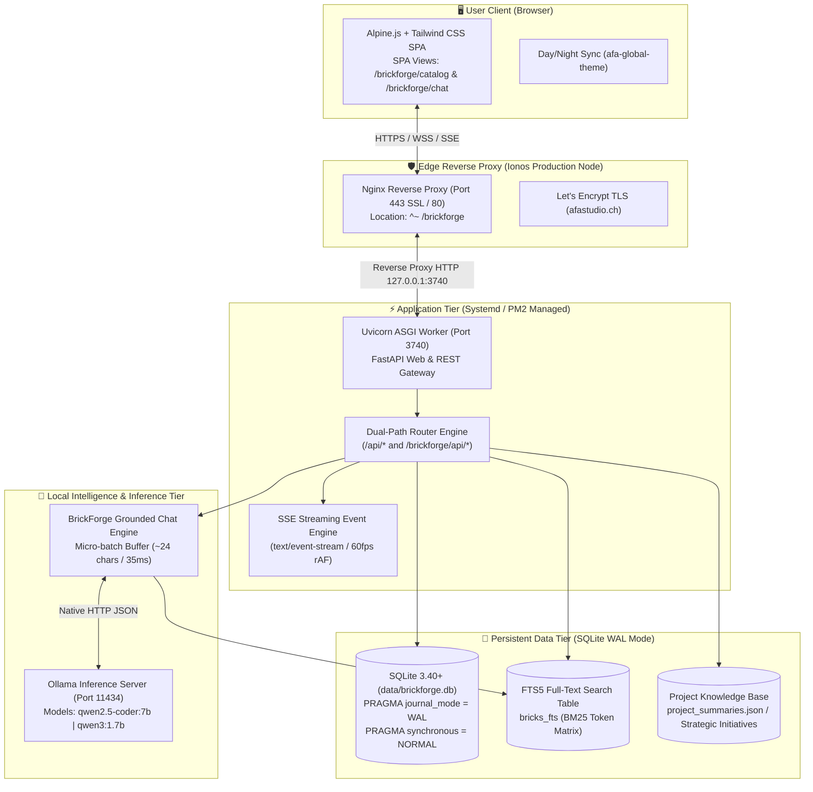
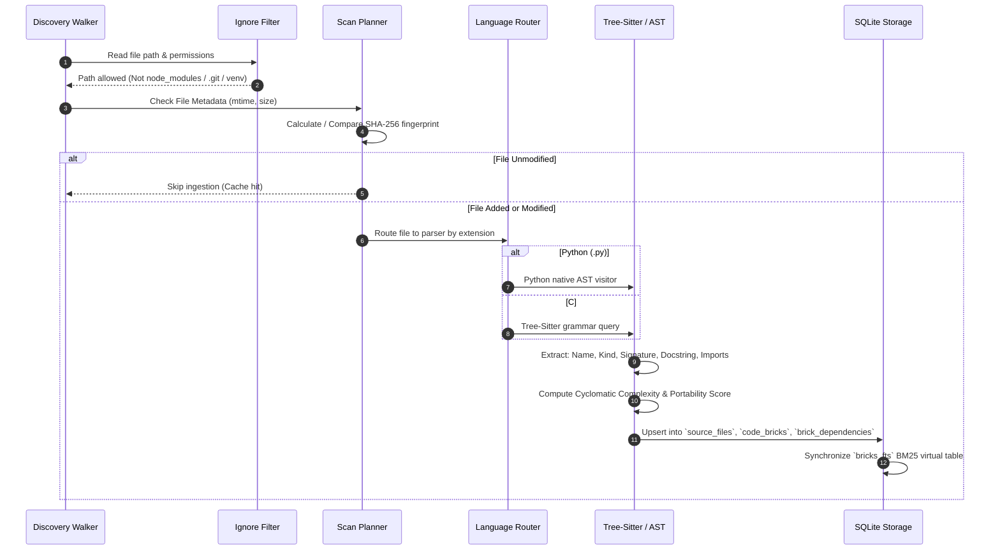

# Technical Architecture Document (TAD) — BrickForge

**System Name:** BrickForge (`brickforge`)  
**Version:** 1.0.0 (Production Ready)  
**Author / Organization:** AFA Studio / Autonomous Agentic Systems  
**Date:** November 2026  
**Status:** Approved / Active Production  

---

## 1. Executive Summary & Architectural Goals

**BrickForge** is a sovereign, offline-first AST code intelligence engine and composable component registry. It transforms multi-repository local file systems and monorepos into an indexed, queryable software catalog containing **160,000+ reusable code modules ("Bricks")** and **280+ architectural projects** spanning 8 programming languages.

### Core Architecture Pillars

1. **Sovereignty & Offline Operation**: Zero reliance on third-party SaaS vector databases or closed-source cloud APIs. Ingestion, SQLite indexing, and LLM inference (via local Ollama) run entirely on local or self-hosted bare-metal nodes.
2. **Deterministic Contract Extraction**: Parsing is non-destructive and static (no code execution during discovery). It extracts strict type signatures, interfaces, dependencies, docstrings, and compute portability scores.
3. **Lexical Precision with FTS5 BM25**: Employs SQLite FTS5 full-text search with tokenized BM25 ranking for exact symbol, syntax, and keyword retrieval without embedding vector drift.
4. **Sub-second Hybrid Ingress & Zero-Build Frontend**: Single-bundle, zero-npm frontend architecture powered by Tailwind CSS and Alpine.js, reverse-proxied through Nginx with SSE streaming.

---

## 2. System Topography & Physical Architecture

The solution deploys across two runtime modes: **Standalone Local Developer Mode** and **Enterprise Self-Hosted Production Node (Ionos Cloud / Nginx)**.

---

## 3. Technology Stack & Component Bill of Materials

| Layer | Component | Version / Spec | Justification & Role |
|---|---|---|---|
| **Language Runtime** | Python | 3.10 – 3.14 (3.12 target) | Multi-core multiprocessing AST parsing, native sqlite3 integration. |
| **API Framework** | FastAPI | 0.115+ | High-throughput asynchronous REST & Server-Sent Events (SSE) streaming. |
| **ASGI Server** | Uvicorn | 0.30+ | Standard asynchronous worker with process supervisor support. |
| **Storage Engine** | SQLite3 + FTS5 | SQLite 3.40+ | Sovereign, single-file ACID persistence; zero-maintenance WAL mode. |
| **AST Parser (Python)**| `ast` standard library | Native Python | Fault-tolerant, recursive AST visitor for functions, classes, and decorators. |
| **AST Parser (Multi-Lang)** | Tree-sitter | `tree-sitter>=0.21.3` | Incremental AST parsing for C#, TypeScript, JavaScript, Rust, C++, Go, Java. |
| **Local LLM Engine** | Ollama | 0.3+ | Local, private LLM execution without external network egress. |
| **Frontend Framework**| Alpine.js + Tailwind CDN | Alpine 3.14.8 | Zero-build, static asset frontend; reactive state without Node.js toolchains. |
| **Reverse Proxy** | Nginx | 1.24+ (Ubuntu) | SSL termination, HTTP/2 multiplexing, SSE buffer unbuffering (`X-Accel-Buffering`). |
| **Process Manager** | PM2 | 5.3+ | Daemon management, zero-downtime reloads, memory guardrails (`1000M`). |

---

## 4. Multi-Language AST Extraction Engine

BrickForge eliminates multi-language parsing divergence by standardizing extracted entities into a uniform AST model:

### Supported Language Grammars

1. **Python**: Native `ast` module extracting top-level and inner classes, async/sync functions, class methods, decorators, type hints, and docstrings.
2. **TypeScript & TSX**: Tree-sitter `tree_sitter_typescript` for interfaces, type aliases, classes, exported arrow functions, and React functional components.
3. **C# (.NET)**: Tree-sitter `tree_sitter_c_sharp` capturing namespaces, classes, structs, records, interfaces, properties, and methods.
4. **Rust**: Tree-sitter `tree_sitter_rust` capturing `struct`, `enum`, `trait`, `impl` blocks, and `fn` functions.
5. **C / C++**: Tree-sitter `tree_sitter_cpp` identifying structs, classes, templates, and function declarations.
6. **Go**: Tree-sitter `tree_sitter_go` capturing package declarations, structs, interfaces, and methods.
7. **Java**: Tree-sitter `tree_sitter_java` capturing classes, interfaces, records, and method signatures.

---

## 5. Grounded RAG & AI Architect Studio Architecture

BrickForge integrates a conversational RAG engine that guarantees LLM responses cite real code in your repositories:

```mermaid
flowchart LR
    subgraph QueryPipeline["1. Query Analysis"]
        UserPrompt["User Chat Message"] --> StopwordStrip["Stopword Stripping & Stemming"]
        StopwordStrip --> Expand["Term Expansion (TTS, DB, Auth, PDF)"]
    end

    subgraph RetrievalEngine["2. Catalog Grounding (FTS5)"]
        Expand --> FTSMatch["FTS5 MATCH (Query Tokens)"]
        FTSMatch --> BM25Rank["BM25 Ranking & Portability Weight"]
        BM25Rank --> CitedBricks["Top 5 High-Value Cited Bricks"]
    end

    subgraph SynthesisEngine["3. LLM Prompt Construction"]
        CitedBricks --> SystemPrompt["Grounded System Instructions<br/>(Injects Signatures, Paths, Contracts)"]
        UserPrompt --> SystemPrompt
        SystemPrompt --> OllamaStream["Ollama HTTP Stream (/api/chat)"]
    end

    subgraph ClientDelivery["4. Micro-Batched Streaming"]
        OllamaStream --> MicroBuffer["SSE Micro-Batcher (~24 chars / 35ms)"]
        MicroBuffer --> WebhookSSE["text/event-stream"]
        WebhookSSE --> BrowserRAF["Browser requestAnimationFrame Render"]
    end
```

---

## 6. Security & Infrastructure Guardrails

1. **Static Analysis Only**: No dynamic code imports (`__import__` or `eval`), eliminating arbitrary code execution during indexing.
2. **Filesystem Isolation**: Path resolution verifies that indexed files remain within registered repository roots; directory traversal attempts (`../`) are blocked.
3. **External Package Boundary**: Distinguishes between local intra-repo dependencies and unverified external PyPI/npm packages.
4. **Sandboxed Subprocess Validator**: When validating bundle extractions (`brickforge test`), executions run in isolated temporary subdirectories with strict timeout limits (10s maximum).
5. **Network Ingress Protection**: Bound locally to `127.0.0.1:3740`; external access is strictly routed through Nginx reverse proxy with TLS encryption, HSTS, and rate limiting.

